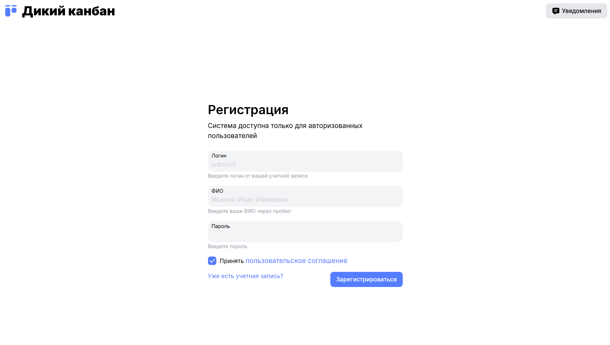
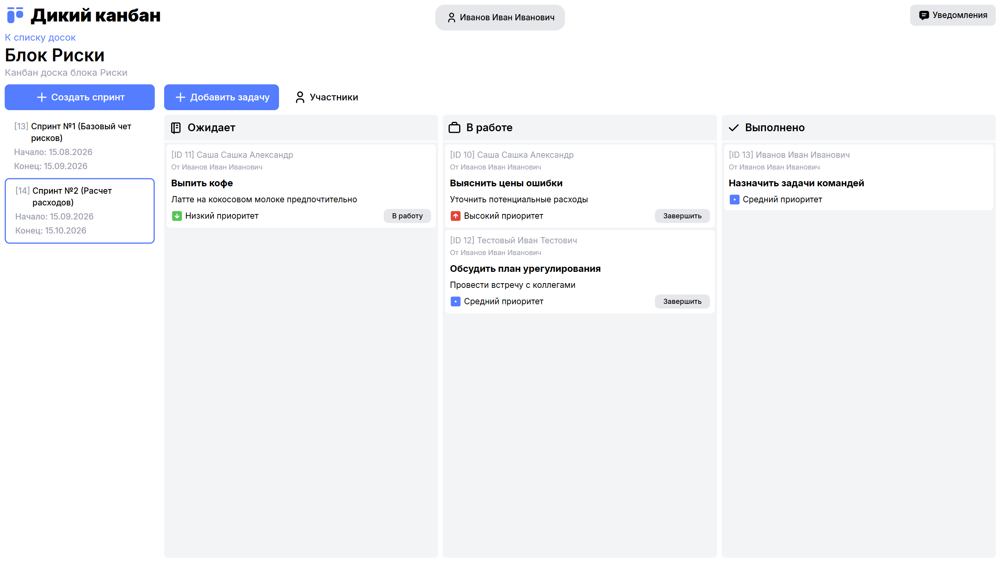

# Канбан-доска на svelte

Реализация минималистичного функционала канбан-досок на SvelteKit

typescript | svelte-kit | bun | vite | vitest | tailwindcss | pino | dbmate | storybook | jwt | docker | nginx | redis | eslint | prettier | di | clean architecture

### Скриншоты

Экран с авторизацией


Экран с канбан-доской


### Реализованный функционал

1. Авторизация через JWT токен, хранимый в куках
2. Создание и просмотр канбан-досок
3. Разграничение доступа пользователей к доскам
4. Создание спринтов и задач в рамках канбан-досок
5. Определение исполнителей для задач
6. Работа с доской в части переноса задач по статусам
7. Функционал уведомлений для пользователя

### Стек

Для реализации приложения был выбран современный фреймворк SvelteKit, используется смешанный
функционал клиентской и серверных частей фреймворка. Часть приложения генерируется на серверной
стороне (SSR), а часть представляет только клиентскую логику (CSR). Хранение данных осуществляется в
реляционной БД Postgres с промежуточным кэшированием в Redis. Проект использует экосистему Bun как
набор инструментов и рантайм для запуска. Приложение упаковано в Docker и может быть развернуто через
docker compose. В прод запуске через docker compose настроено проксирование через обратный прокси
сервер на nginx

### Из чего состоит проект

В основе проекта лежит модифицированная чистая архитектура, рассчитанная c учетом особенностей
разработки fullstack-приложений на SvelteKit. Предполагается разделение на три основных слоя:
app, view, routes. Реализована кастомная имплементация DI контейнера для соблюдения принципа
инверсии зависимостей

#### Слой app

Состоит из срезов:

- core - общие вспомогательные инструменты для использования в любой части приложения
- entities - набор бизнес-сущностей присущих продукту
- http - срез для работы с клиент-серверным взаимодействием (взаимодействием между front и back частями приложения)
- repos - набор репозиториев для работы с БД
- services - адаптеры для работы с подключаемыми пакетами/библиотеками
- store - имплементации сторов (не требует подключения сторонних пакетов с учетом использования svelte)
- use-cases - перечень сценариев для реализации бизнес-логики приложения

#### Слой view

Состоит из срезов:

- components - компоненты используемые на страницах приложения, разделенные по смыслу
- form-validators - вспомогательные инструменты для валидации форм на клиентской стороне
- ui - рукописная библиотека компонентов
- wrappers - хуки в экосистеме svelte

#### Слой routes

Представляет собой платформ-специфичный слой в стиле file-based router, где директория api
предназначается для реализации в ней backend API приложения, а все остальные директории непосредственно роутинг front части приложения с поддержкой SSR

### Запуск приложения

#### Запуск в DEV режиме

1. Запустить необходимое окружение (БД и кеш) через докер

```bash
docker compose -f ./docker-compose.dev.yaml up -d
```

2. Выполнить миграции через dbmate. Необходимо только при первом запуске, при условии что не были
   очищены тома в докере

```bash
bunx dbmate up
```

3. Запустить проект через Bun

```bash
bun run dev
```

#### Запуск в PROD режиме

Необходимо выполнить команду

```bash
docker compose up -d
```
